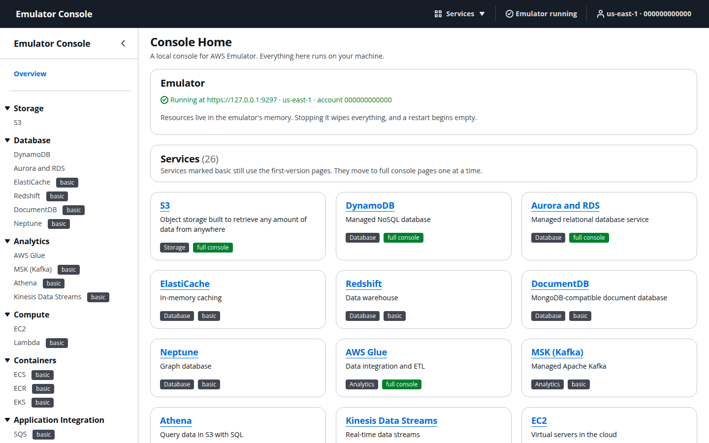

<div dir="rtl">

<div align="center">

# AWS Emulator Console

**كونسول AWS كامل شغال على جهازك، فوق [AWS Emulator](https://github.com/aws/aws-emulator).**

اعمل S3 buckets، وطلّع EC2 instances، وشغّل databases حقيقية (MySQL وPostgreSQL)، واعمل crawl لبياناتك وشغّل Glue jobs، كله من واجهة شكلها وطريقة شغلها زي كونسول AWS بالظبط. مش محتاج حساب AWS، ومفيش فلوس، ومفيش حاجة بتخرج من جهازك.

[English](README.md) · [الدوكيومنتيشن](docs/) · [الخطة](docs/ROADMAP.md)



</div>

> **ده مش منتج رسمي من AWS.** مشروع مفتوح المصدر من المجتمع، بيكلم الإيميوليتور اللي على جهازك بس، وعمره ما بيكلم حساب AWS حقيقي.

## المشروع ده بيعمل إيه؟

AWS Emulator بيشغّل خدمات AWS على جهازك، بس من غير أي واجهة: لازم تستخدمه بالـ CLI أو بالكود. المشروع ده بيضيف له كونسول ويب كامل:

- **تتعلم AWS** على نفس الشاشات الحقيقية، من غير فلوس ومن غير خوف إنك تنسى حاجة شغالة.
- **تطوّر وتختبر على جهازك:** تعمل الـ resources اللي التطبيق محتاجها، وتشوف الكود بتاعك عمل إيه، وتعدّل البيانات بإيدك.
- **تشرح وتعمل demos** من غير حسابات ولا إنترنت.
- **تعرف الإيميوليتور بيدعم إيه:** الحاجات اللي مش مدعومة موجودة في القوايم بعلامة **n/a** ومعاها السبب.

الواجهة مبنية بـ [Cloudscape](https://cloudscape.design)، نفس نظام التصميم اللي AWS بتبني بيه الكونسول بتاعها.

## الخدمات

| الخدمة | المستوى |
|---|---|
| **S3** | ✅ كونسول كامل: الـ buckets بكل الإعدادات، والرفع، والإصدارات، والـ lifecycle، والـ replication، والـ notifications |
| **DynamoDB** | ✅ كونسول كامل: الجداول، والـ indexes، وExplore items، وPartiQL، والـ backups، والـ export/import |
| **EC2** | ✅ كونسول كامل: الـ instances بكل الـ actions، وLaunch wizard، والـ volumes، والـ security groups، والـ load balancers، وAuto Scaling |
| **Aurora and RDS** | ✅ كونسول كامل: Create database لـ 8 engines، وModify، والـ replicas، والـ failover، والـ snapshots، والـ proxies، والـ parameter groups |
| **AWS Glue** | ✅ كونسول كامل: الكتالوج، والـ crawlers، وجداول بتعرض بياناتها عن طريق Athena، وData quality، وScript editor jobs، والـ triggers، والـ workflows بالرسمة |
| **Amazon ECS** | ✅ كونسول كامل: الكلاسترات، وإدارتها بـ Fargate وEC2، والـ Task definitions بمحرر Form وJSON، وتشغيل الـ Services وTasks مع ربط الـ Load Balancer والشبكات |
| **Amazon ECR** | ✅ كونسول كامل: مستودعات الـ Docker/OCI، وخيارات الـ Tag immutability، وScan on push، ومحرر الـ Lifecycle policies، وأوامر الـ Push للـ CLI |
| **Amazon EKS** | ✅ كونسول كامل: كلاسترات Kubernetes 1.31، وأمر الاتصال بـ kubeconfig، وإدارة الـ Managed node groups، وتثبيت الـ Add-ons (مثل VPC CNI وCoreDNS) |
| باقي الخدمات (MSK وLambda وSQS وغيرهم) | صفحات أساسية، بتتنقل للكونسول الكامل واحدة واحدة |

## حاجات بتشتغل بجد

- **قواعد البيانات:** MySQL وMariaDB وPostgreSQL وAurora بيشتغلوا كسيرفرات حقيقية على `127.0.0.1`، وصفحة الـ database بتديك أمر الاتصال.
- **Glue crawlers:** بتقرأ ملفاتك في S3 وتطلّع الجداول والـ partitions.
- **Glue jobs:** بتشغّل كود Python وPySpark بجد، وبتكتب النتيجة في S3.
- **Athena:** بيشغّل SQL على البيانات.
- **Lambda:** بتشغّل الكود.
- **Load balancers:** بترد على HTTP على جهازك.

التفاصيل الكاملة في [docs/EMULATOR_NOTES.md](docs/EMULATOR_NOTES.md).

## التسطيب

### المتطلبات

- [AWS Emulator](https://github.com/aws/aws-emulator). اتجرب على إصدار 1.0.385.
- Python 3.10 أو أحدث.
- Node.js إصدار 20.19 أو أحدث (أو 22)، عشان الـ build بس.
- Git.

الإيميوليتور بيشتغل مباشرة على **Linux**. على **macOS وWindows** بيشتغل جوه **Docker**.

### الخطوة 1: سطّب الإيميوليتور

**Ubuntu / Debian:**

</div>

```bash
curl -fsSLo aws-emulator.deb https://downloads.aws.com/aws-emulator/packages/aws-emulator/LTS/latest/aws-emulator_amd64.deb
sudo apt-get install -y ./aws-emulator.deb
aws-emulator -v
```

<div dir="rtl">

**Fedora / RHEL / Amazon Linux:**

</div>

```bash
sudo dnf install -y https://downloads.aws.com/aws-emulator/packages/aws-emulator/LTS/latest/aws-emulator-x86_64.rpm
```

<div dir="rtl">

لو جهازك ARM، استخدم `aws-emulator_arm64.deb` أو `aws-emulator-aarch64.rpm`.

**macOS وWindows:** اعمل Docker image من الـ Dockerfile اللي في [الـ README الإنجليزي](README.md#step-1-install-and-start-the-aws-emulator)، وشغّله بالأمر اللي هناك. لازم الـ volume بتاع `~/.aws/emulator` يتعمل له mount، عشان الكونسول بياخد المفاتيح والشهادة من هناك.

### الخطوة 2: نزّل المشروع

</div>

```bash
git clone https://github.com/SayedELMASRY2/aws-emulator-console.git
cd aws-emulator-console
```

<div dir="rtl">

### الخطوة 3: شغّله

</div>

```bash
./start.sh
```

<div dir="rtl">

أول مرة بياخد دقيقة: بيعمل Python environment، ويسطب boto3، ويعمل build للواجهة. بعدها افتح **http://127.0.0.1:8297**، ولازم الشريط اللي فوق يكون مكتوب فيه **Emulator running**.

على Linux، لو الإيميوليتور مش شغال، السكريبت بيشغّله، ولما تقفل بـ Ctrl+C بيقفله معاه.

**تسطيب يدوي (أي نظام، ومنهم Windows):**

</div>

```bash
python3 -m venv .venv
.venv/bin/pip install -r requirements.txt     # Windows: .venv\Scripts\pip install -r requirements.txt
cd web && npm ci && npm run build && cd ..
.venv/bin/python server.py                     # Windows: .venv\Scripts\python server.py
```

<div dir="rtl">

## أول خمس دقايق

1. **S3:** اعمل bucket وارفع فيه ملف CSV جوه فولدر اسمه `sales/`.
2. **Aurora and RDS:** من Create database اختار MySQL، واختار **Auto generate password**، وانسخ الباسورد من الرسالة الزرقا. لما الـ database تبقى Available، تاب Connectivity & security هيديك أمر `mysql` تتصل بيه بسيرفر حقيقي.
3. **AWS Glue:**
   1. من Getting started دوس **Set up IAM role**.
   2. اعمل crawler على `s3://<bucket>/sales/` وشغّله.
   3. افتح الجدول اللي طلع، ودوس **View data**.
4. **ETL job:** من ETL jobs، تحت Script editor، اختار Spark. اكتب سكريبت يقرأ الجدول ويكتب CSV في S3، ودوس **Run**.

> الإيميوليتور بيحفظ كل حاجة في الذاكرة، فأي restart بيمسح كل الـ resources.

## استخدام الـ AWS CLI مع الكونسول

اللي بتعمله في الكونسول بيظهر في الـ CLI والكود والعكس، لأن الاتنين بيكلموا نفس الإيميوليتور:

</div>

```bash
export AWS_ENDPOINT_URL=https://127.0.0.1:9297
export AWS_SHARED_CREDENTIALS_FILE=~/.aws/emulator/9297/emulator_credentials
export AWS_CONFIG_FILE=~/.aws/emulator/9297/config
export AWS_CA_BUNDLE=~/.aws/emulator/9297/ca.pem
export AWS_EC2_METADATA_DISABLED=true
export AWS_DISABLE_HOST_PREFIX_INJECTION=true
export AWS_REGION=us-east-1 AWS_DEFAULT_REGION=us-east-1
aws s3 ls
```

<div dir="rtl">

## مشاكل شائعة

| المشكلة | الحل |
|---|---|
| مكتوب **Emulator not running** | شغّل الإيميوليتور (`aws-emulator` أو أمر Docker) واعمل refresh |
| البورت 8297 مستخدم | شغّل `UI_PORT=8080 ./start.sh` |
| الـ build فشل | اتأكد إن `node -v` إصداره 20.19 أو أحدث، وبعدها `npm ci` تاني |
| الـ resources اختفت | الإيميوليتور اتعمل له restart، وهو بيحفظ في الذاكرة بس |
| Glue job فشل بـ AccessDenied | دوس **Set up IAM role** في Glue، أو ادي الـ role صلاحية على S3 |

## الدوكيومنتيشن

- [docs/ARCHITECTURE.md](docs/ARCHITECTURE.md): المشروع متركب إزاي.
- [docs/STATUS.md](docs/STATUS.md): اللي خلص وكل خدمة اتجربت إزاي.
- [docs/ROADMAP.md](docs/ROADMAP.md): اللي لسه، بالترتيب، وخطة كل خدمة.
- [docs/ADDING_A_SERVICE.md](docs/ADDING_A_SERVICE.md): خطوات إضافة خدمة جديدة.
- [docs/EMULATOR_NOTES.md](docs/EMULATOR_NOTES.md): إيه اللي شغال وإيه اللي مش شغال في الإيميوليتور.
- [AGENTS.md](AGENTS.md): تعليمات لأي AI agent هيشتغل على المشروع.
- [CONTRIBUTING.md](CONTRIBUTING.md): إزاي تساهم.

## الترخيص

MIT. التفاصيل في [LICENSE](LICENSE).

</div>
